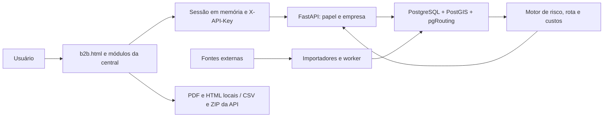

# Arquitetura, fontes e atualização

O painel original continua responsável por mapa, tabela, chuva, despacho, frota
e auditoria. Os módulos `painel-*.js` e `portal-*.js` acrescentam fluxos na mesma
página, sem segundo motor de rotas ou custos. `painel-sessao.js` centraliza
transporte, cancelamento e papéis. O backend calcula e persiste; o frontend
formata e permite conferir. Sessões individuais são revogáveis; chaves de
integração identificam empresa/papel, sem atribuir autoria individual falsa.

O banco contém dados públicos compartilhados e dados privados filtrados por
empresa. Consultas e decisões guardam fotografias; mudanças posteriores não
reescrevem o passado. Índice IVI, natureza da informação e confiança heurística
não são probabilidades calibradas de ocorrência.

## Fontes: publicação versus execução

| Informação | Origem e mecanismo | Atualização e limite |
| --- | --- | --- |
| Acidentes/tombamentos | Importador ARTESP, URL e hash na procedência | Publicação histórica/periódica; não informa tombamento ao vivo nem interdição atual |
| Roubo de carga | SSP-SP, importador de agregados regionais | Recortes trimestrais; não localiza crime em uma rua específica nem prevê viagem individual |
| Combustível | ANP, preços pesquisados e cadastro de postos | Coleta/publicação semanal conforme conjunto; cobertura de amostra, sem garantia do preço atual em cada posto |
| Postos/localização | Cadastro ANP e correspondência de estabelecimento | Coordenada candidata pode exigir conferência; não garante acesso seguro para caminhão |
| Pedágios | Catálogo/importação, fonte e vigência da tarifa | Conferência por praça/categoria/eixos e sentido; cobertura parcial, tarifa desconhecida não é zero |
| Pontes/restrições | Tags da malha OSM e registros de infraestrutura importados | Atualidade depende da importação e da completude das tags; ausência de limite não confirma passagem |
| Malha | OpenStreetMap, PostGIS e pgRouting | Conectividade e snap dependem da malha importada; consulta de referência não cadastra corredor do cliente |
| Clima | Script de sincronização/Open-Meteo; integração CGE limitada | Scheduler do backend tenta a cada 30 min somente fora da demo e de produção; tentativa não prova leitura atual. Em produção, a coleta gratuita fica desligada até haver fonte aprovada para uso comercial |
| Trânsito/ocorrências | Endpoints/importações e relatos com natureza explícita | Conferir observação, validade e fonte. Relato de usuário não é confirmação |
| Demonstração | Base CI e exercício sintético reservado | Nenhum dado de exercício deve ser interpretado como condição real; referência histórica pesquisada é identificada separadamente |

`scripts/worker_dados_publicos.py` tenta ARTESP, ANP mensal e semanal, cadastro ANP e SSP a cada
24 horas por padrão (`DADOS_PUBLICOS_INTERVALO_HORAS`, permitido 1–168).
Isso só ocorre **se o worker estiver implantado e ativo**, não por abrir o mapa.
O período de tentativa não muda a frequência de publicação do fornecedor.
Falhas são auditadas a partir da instrumentação, sem reconstruir o passado.
O scheduler climático não roda na demonstração isolada nem em produção.

## Procedência, cobertura e licenças

Consultar **Painel operacional interno** para idade, expectativa de atualização,
falhas, serviço e métricas. `/api/v1/operacional/fontes` e
`/api/v1/operacional/importacoes` exigem ADMIN. Indicadores de saúde não atestam
cobertura ou licença. Revalidar os termos de cada fornecedor antes de distribuir
dados; a disponibilidade pública de um arquivo não autoriza afirmar licença
irrestrita. Preservar atribuição OSM e a origem dos demais conjuntos.

URLs específicas, datas e limitações dos conjuntos estão nos registros de fonte
e nestes guias:

- [Verificação das fontes públicas em 19/10/2026](documentacao_fontes.md).
- [Dados de riscos e combustíveis](dados-riscos-combustiveis.md).
- [Integração de dados de viagem](integracao-dados-viagem.md).
- [Integração de caminhões](integracao-caminhoes.md).
- [Painel interno](painel-operacional-interno.md).
- [Demonstração isolada](demonstracao-isolada.md).

Não consultar sites externos a cada desenho do mapa: importação e processamento
ficam no servidor, com leitura dos resultados pelo painel. Configurar coleta,
monitorar validade e conservar a última data conhecida; em falha, mostrar
limitação sem alegar que a rota está livre.
